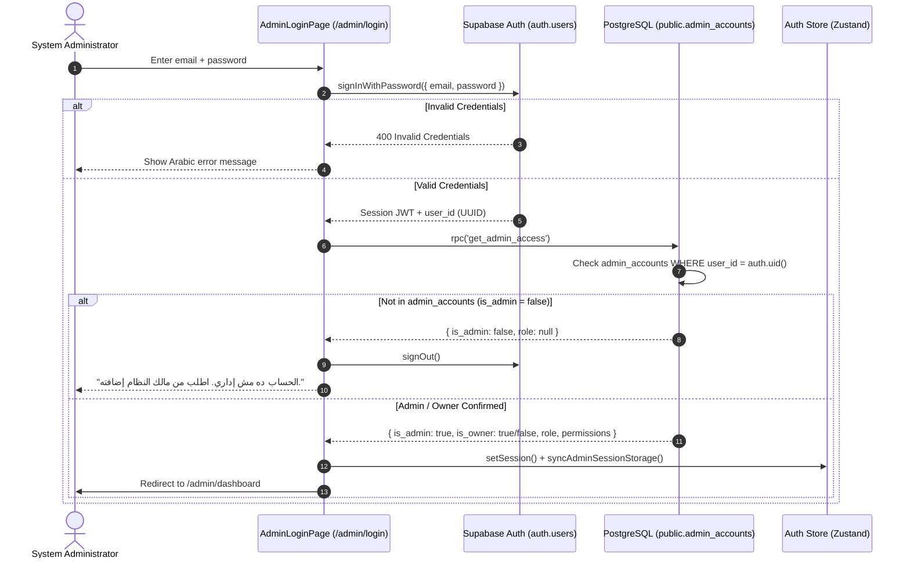
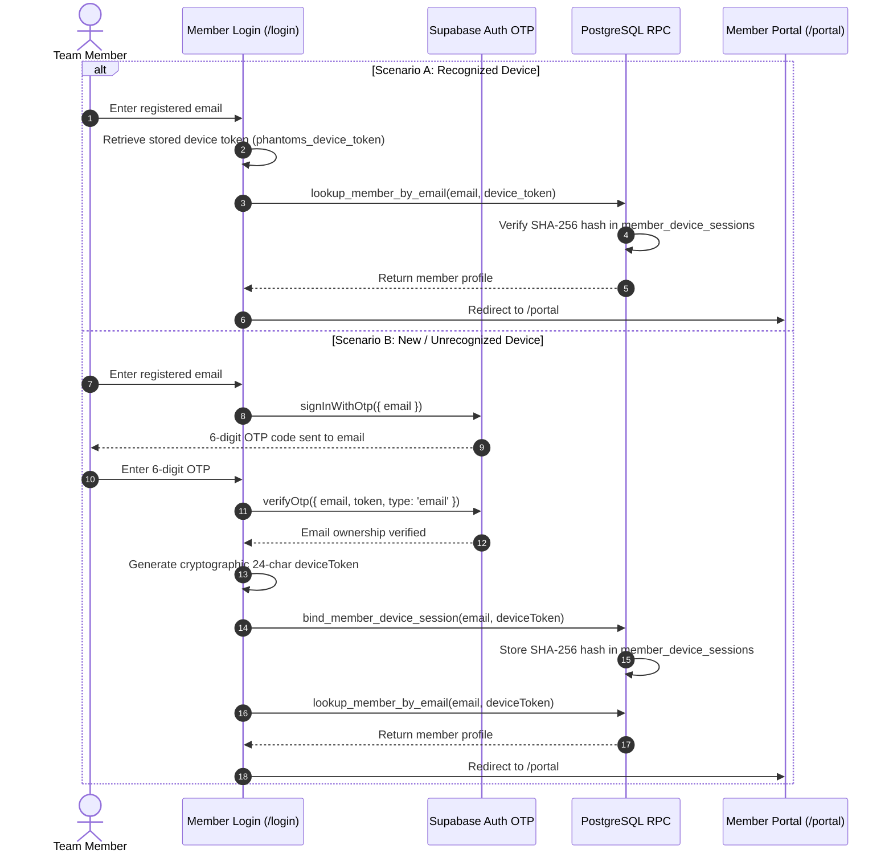

# PHANTOMS — Dashboard-First Launch & Legacy Wasla Migration Audit

**Document Reference:** `PHANTOMS-AUDIT-2026-11-10-LAUNCH-MIGRATION`  
**Target Repository:** `TheSeifDev/dashboard-phantoms` (`C:\projects\phantoms\dashboard`)  
**Target Environment:** Vercel (Frontend SPA) + Supabase (`cbuiwgrmsmsidyjhzvla`)  
**Audit Status:** COMPLETE — STRICT AUDIT MODE (ZERO CODE / ZERO DB CHANGES)  
**Date:** November 10, 2026  
**Auditor:** Principal Full-Stack Architect, Supabase DBA, Security Engineer & Release Manager  

---

## Executive Summary

This comprehensive audit evaluates the readiness of the **PHANTOMS Operations & Team Management Platform** to launch its core dashboard immediately while the WhatsApp subsystem remains safely disabled. In parallel, it audits the database migration sequence (`0001` through `0022`), classifies all remaining legacy "Wasla" occurrences repository-wide, and details the verified administrative authentication and member onboarding architecture.

### Key Conclusions:
1. **Dashboard Independence:** The core Operations Platform (Admin Control Center, Member Directory, Task Management & Verification, Bonus & Leaderboards, Member Evaluations, Custom Fields, System Announcements, Team Notes, and AI Assistant) is **100% architecturally decoupled from WhatsApp**. The application builds, runs, and functions flawlessly without the WhatsApp bridge or Meta Cloud API online.
2. **Database Push Status:** The live Supabase instance (`cbuiwgrmsmsidyjhzvla`) has **ZERO tables** in `public`. Database migrations have **NOT** been applied.
3. **Critical Migration Prerequisite:** Migration files `0001` through `0022` in `backend/migrations/` are incremental alteration scripts. Running `0001_security_hardening.sql` directly on a blank database fails immediately because base tables (`members`, `tasks`, `notes`, `whatsapp_settings`, `admin_emails`) originate in `backend/supabase_setup.sql`. `backend/supabase_setup.sql` must be formalized as Migration `0000_base_schema.sql` before applying `0001`–`0022`.
4. **Ownership Decoupling:** Migration `0022_dynamic_system_ownership.sql` successfully decouples the system from the legacy hardcoded owner UUID (`8ce17aae-84c1-4c89-a020-8b683a0dbabb`). Dynamic ownership is now anchored to `public.admin_accounts (role = 'owner')`.
5. **Admin & Member Authentication:** Admins authenticate via Supabase Auth email/password, authorized strictly via `public.admin_accounts`. Team members authenticate via cryptographic device tokens bound to `public.member_device_sessions` with mandatory email OTP verification for new devices. Members cannot escalate privileges.
6. **Frontend Build Verification:** Production frontend compilation (`tsc -b && npm run ux:guard && vite build`) passes with **0 errors**.

---

## Phase 1: Dashboard Independence & WhatsApp Isolation

### 1.1 Architecture Independence Assessment

The PHANTOMS platform was audited to determine whether any core operational capability depends on WhatsApp availability.

| Subsystem / Feature | Direct WhatsApp Dependency? | Impact if WhatsApp is Offline / Disabled |
|---|---|---|
| **Admin Authentication (`/admin/login`)** | None | Zero impact. Authenticates via Supabase Auth. |
| **Dashboard Metrics (`/admin/dashboard`)** | None | Zero impact. Queries PostgreSQL `members`, `tasks`, `notes`. |
| **Members Directory (`/admin/members`)** | None | Zero impact. Full CRUD, custom fields, and Excel import/export operate locally. |
| **Task Management (`/admin/tasks`)** | None | Zero impact. Task assignment, deadline tracking, proof submission, and multi-stage approval work directly via DB. |
| **Leaderboard & Ranking (`/admin/ranking`)** | None | Zero impact. Calculates scores, tiers, completion ranks, and bonus transactions. |
| **Team Notes (`/admin/notes`)** | None | Zero impact. Notes CRUD works directly via PostgreSQL. |
| **Evaluations (`/admin/evaluations`)** | None | Zero impact. Evaluation metrics stored in `member_evaluations`. |
| **Announcements (`/admin/announcements`)** | Opt-in toggle | Core announcement is published immediately. WhatsApp dispatch is optional. |
| **AI Operational Assistant (`/admin/ai-assistant`)** | None | Calls `phantoms-ai` Edge Function directly. |
| **Member Portal (`/portal`)** | None | Session token & OTP verification operate independently. In-app notifications use browser audio chimes & Web Push. |
| **Web Push Notifications** | None | Handled via VAPID / `push-notify` Edge Function and browser Service Worker. |

### 1.2 WhatsApp Invocation Touchpoints

All repository touchpoints that interact with WhatsApp were identified and audited:

1. **Dedicated Route `/admin/whatsapp` (`WhatsAppTasksPage.tsx`):**
   - Displays three sub-views: `WhatsAppQRPage`, `WhatsAppCloudPage`, and `WhatsAppDiagnostics`.
   - Protected by admin permission flag `permissions.whatsapp`.
   - If the WhatsApp Bridge is offline or unconfigured, the page renders an informational alert ("رابط خدمة واتساب مش مضبوط") without throwing unhandled exceptions or affecting navigation.
2. **Announcement Creation Modal (`CreateAnnouncementModal.tsx`):**
   - Contains a checkbox: `send_whatsapp` (default: `false`).
   - If checked by the admin, line 141 calls `sendWhatsAppAnnouncement(created.id, mIds)`.
   - **Graceful degradation:** The call is wrapped in a `try/catch` block. If WhatsApp dispatch fails, the announcement remains successfully created and published to the database; the UI simply surfaces a toast notification alerting the admin that WhatsApp notification failed.
3. **WhatsApp Task Dispatch Modal (`WhatsAppConfirmModal.tsx` / `WhatsAppDispatch.tsx`):**
   - Dispatches task assignment notifications. Only reachable from `/admin/whatsapp`.
4. **Member Portal In-App Notification Center (`WhatsAppNotificationCenter.tsx`):**
   - Despite its name, this component is an **internal in-app notification center** for the member portal. It listens to Supabase broadcast / service worker messages and plays an in-memory synthetic audio chime (`AudioContext`). It makes **no network calls** to WhatsApp or Meta APIs.

### 1.3 Degradation & Failure Handling

- **Missing/Unreachable Bridge URL:** In `frontend/src/features/whatsapp/api.ts`, `RAW_BRIDGE_URL` falls back to `http://localhost:3030`. When `import.meta.env.VITE_WHATSAPP_BRIDGE_URL` is omitted or invalid, `getWhatsAppBridgeUrl()` returns `null` or a structured configuration error (`BRIDGE_MISCONFIGURED_MESSAGE`). All API calls return structured error envelopes (`{ accepted: false, errors: [...] }`) rather than unhandled promise rejections.
- **Database Level Disable Flag:** In `public.whatsapp_settings`, the row `id = 1` contains `enabled BOOLEAN DEFAULT false`. When `enabled = false`, both `whatsapp-tasks` (Meta Cloud API Edge Function) and `whatsapp-bridge` reject message dispatch requests with HTTP 403 / structured Arabic rejection reasons.
- **Web Push Independence:** Push notifications to mobile and desktop browsers use the Web Push standard (VAPID) via the `push_subscriptions` table and the `push-notify` Edge Function. They have zero dependency on WhatsApp.

### 1.4 Temporary Disablement Strategy (Zero Code Deletion)

To safely launch the Dashboard while WhatsApp is temporarily disabled:
1. **Database Flag:** Keep `public.whatsapp_settings.enabled = false` (the default).
2. **Environment Variable:** Omit `VITE_WHATSAPP_BRIDGE_URL` or leave it empty in production Vercel environment variables.
3. **UI Safe Harbor:**
   - In `CreateAnnouncementModal.tsx`, the `send_whatsapp` toggle defaults to unchecked (`false`). Admins can simply leave it disabled.
   - In `frontend/src/features/admin/access/permissions.ts`, the `whatsapp` permission can be toggled off for standard admins, hiding the sidebar link.
   - Zero lines of WhatsApp bridge or Edge Function code need to be deleted or commented out.

---

## Phase 2: Database Migration Readiness & Schema State

### 2.1 Live Database State Verification

A non-destructive HTTP REST query was executed against the production Supabase project (`cbuiwgrmsmsidyjhzvla`):

```http
GET /rest/v1/members?select=id HTTP/1.1
Host: cbuiwgrmsmsidyjhzvla.supabase.co
apikey: [REDACTED_ANON_KEY]
```

**Response:**
```json
HTTP/1.1 404 Not Found
{"code":"PGRST205","details":null,"hint":null,"message":"Could not find the table 'public.members' in the schema cache"}
```

**Finding:** The live Supabase instance has **zero application tables**. Neither `supabase db push` nor any manual SQL migration script has been applied to this project.

### 2.2 Complete Migration Analysis (`0001` through `0022`)

The migration scripts in `backend/migrations/` were audited in numerical sequence:

| Migration File | Primary Responsibility | Dependencies / Target Tables | Destructive Operations? |
|---|---|---|---|
| **`0001_security_hardening.sql`** | Hardens RLS policies on members, tasks, notes | Requires `members`, `tasks`, `notes` | **FAILS ON CLEAN DB** (assumes base tables exist) |
| **`0002_whatsapp_bridge_settings.sql`** | Creates `whatsapp_settings` & `whatsapp_secrets` | Drops initial `whatsapp_settings` table | Drops table if exists |
| **`0003_secure_whatsapp_vault.sql`** | Secures Supabase Vault access for WhatsApp | Alters `whatsapp_secrets` | None |
| **`0004_member_attendance_locations.sql`** | Adds attendance columns | Alters `members` | None |
| **`0005_task_verification_workflow.sql`** | Adds status verification fields | Alters `tasks` | None |
| **`0006_remove_team_concept.sql`** | Unifies members into single organization | Drops `team` column from `members` | **Drops column `team`** (safe for new DB) |
| **`0007_announcements_system.sql`** | Creates announcements & read receipts tables | Creates `announcements`, `read_receipts` | None |
| **`0008_admin_email_rls.sql`** | Hardens admin emails lookup table | Replaces policies on `admin_emails` | None |
| **`0009_member_device_binding.sql`** | Adds device token binding for member portal | Creates `member_devices`, adds RPCs | None |
| **`0010_announcement_target_members.sql`** | Adds targeted member arrays to announcements | Alters `announcements` | None |
| **`0011_member_attendance_records.sql`** | Adds attendance logging | Creates `member_attendance_records` | None |
| **`0012_system_audit_logs.sql`** | Adds system audit trails | Creates `audit_logs` | None |
| **`0013_member_device_sessions.sql`** | Transitions auth to SHA-256 session tokens | Creates `member_device_sessions` | Replaces device binding RPC |
| **`0014_admin_access_control.sql`** | Creates admin accounts table | Creates `admin_accounts (user_id, role)` | Hardcoded UUID introduced here |
| **`0015_admin_permissions_and_full_delete.sql`** | Granular permissions & cascade delete | Alters `admin_accounts`, adds delete RPCs | None |
| **`0016_member_infinite_bonus.sql`** | Concurrency-safe bonus adjustments | Adds bonus RPC with write token lock | None |
| **`0017_web_push_notifications.sql`** | Adds Web Push subscriptions | Creates `push_subscriptions` | None |
| **`0018_task_approval_reversal_and_ratings.sql`** | Task approval reversal & rating RPCs | Adds reversal & rating RPCs | None |
| **`0019_member_information_and_ratings.sql`** | Member rating view & statistics | Creates rating views & aggregates | None |
| **`0020_member_custom_fields.sql`** | Dynamic custom fields engine | Creates `member_custom_fields`, alters `members` | None |
| **`0021_member_evaluations.sql`** | Performance evaluations system | Creates `member_evaluations` | None |
| **`0022_dynamic_system_ownership.sql`** | Decouples hardcoded owner UUID & hardens OTP | Rewrites `is_admin()`, `is_owner()`, `get_admin_access()` | Safely removes hardcoded UUID |

### 2.3 The Critical Prerequisite Gap: Missing `0000_base_schema.sql`

`0001_security_hardening.sql` begins with:
```sql
DROP POLICY IF EXISTS "allow_admin_write" ON public.members;
CREATE POLICY "members_admin_policy" ON public.members ...
```
Because `public.members` does not yet exist on a clean Supabase database, executing `0001` directly fails with:
`ERROR: relation "public.members" does not exist`.

**Root Cause:**
The original baseline database schema resides in `backend/supabase_setup.sql`. It defines:
- `public.members`
- `public.tasks`
- `public.notes`
- `public.whatsapp_settings`
- `public.admin_emails`
- Base triggers (`guard_anon_tracking_update`) and Vault helper functions (`set_groq_key`, `get_groq_key_from_vault`).

**Remediation Action Required Before Migration:**
1. Formalize `backend/supabase_setup.sql` as `backend/migrations/0000_base_schema.sql` (or apply it as Step 0 in the execution runner).
2. Sequence: `0000` -> `0001` -> `0002` -> ... -> `0022`.

### 2.4 Runner Defect in `frontend/scripts/run-migrations.mjs`

Audit of `frontend/scripts/run-migrations.mjs` revealed two blocking defects:
1. **Target Project:** Line 9 targets hardcoded project `https://mukqrnmveydxfphftlaq.supabase.co` (an old deleted project) instead of reading from environment variables or targeting `cbuiwgrmsmsidyjhzvla`.
2. **Non-Existent RPC:** Line 61 attempts to execute SQL via `supabase.rpc('exec_sql', { sql })`. The `exec_sql` RPC is not a native Supabase function; running this script fails with `function exec_sql() does not exist`.

**Approved Migration Execution Method:**
Migrations must be executed either via the official **Supabase CLI** (`supabase db push` / `supabase migration up` linked to `cbuiwgrmsmsidyjhzvla`) or via a Node.js PostgreSQL client script connecting directly via `DATABASE_URL` (direct PostgreSQL connection string on port 5432/6543).

---

## Phase 3: Wasla → PHANTOMS Classification Inventory

A complete repository scan for legacy branding identifiers (`wasla`, `Wasla`, `WASLA`, `وصلة`, `وصله`) was conducted across all tracked files.

### 3.1 Classification Summary Table

| Category | Description | Count | Action Required Before Launch |
|---|---|---|---|
| **Category A** | User-Facing Text & UI Components | **0** | **None.** Active UI is 100% migrated to PHANTOMS. |
| **Category B** | Internal Identifiers, LocalStorage Keys, Fallback Env Vars | **192** | **Preserve for backward compatibility.** Migration layers in place. |
| **Category C** | Documentation, Specifications, Architectural Runbooks | **15** | **Documentation update only.** Non-blocking. |
| **Category D** | Historical Audit Reports, Reviewer Logs, Archived `legacy/` | **466** | **Retain as historical record.** Non-blocking. |
| **Category E** | Database Schema, Migration Scripts, SQL Defaults | **17** | **Preserve.** Altering past migrations risks checksum drift. |
| **Category F** | Third-Party Dependencies, External CSP, Capacitor Config | **3** | **Update `vercel.json` CSP before production.** |
| **Total** | **All Unique Occurrences** | **693** | |

### 3.2 Category Breakdown Details

#### Category A: User-Facing Text & UI (0 active occurrences)
All user-visible application titles, headers, navigation items, buttons, modals, and badges in `frontend/src/` have been verified. The application displays:
- Application Title: `PHANTOMS Operations & Team Management Platform`
- Portal Headings: `مركز إدارة العمليات — PHANTOMS` / `بوابة الفريق — PHANTOMS`
- Note: A single administrative fallback label exists in `WhatsAppCloudPage.tsx:124` displaying `{status.data?.templateName || 'wasla_task_assignment'}` if Meta template configuration is omitted.

#### Category B: Internal Identifiers & Environment Variables (192 occurrences)
These occurrences are deliberate compatibility layers:
- `frontend/src/lib/storageMigration.ts`: Automatically migrates legacy keys (`wasla_device_token` -> `phantoms_device_token`, `wasla_member_session` -> `phantoms_member_session`).
- `frontend/src/store/auth.ts`: Fallback lookups (`localStorage.getItem('phantoms_admin_remember') ?? localStorage.getItem('wasla_admin_remember')`).
- Historical carrier prefixes: `EVAL_CARRIER_PREFIX = '[[WASLA_EVAL]]'` and `CF_MARKER_PREFIX = '[[WASLA_CF:'`. These must remain to ensure legacy records are decoded correctly without data loss.
- Edge Function CORS fallbacks: `WASLA_ALLOWED_ORIGINS` and `WASLA_APP_URL` are supported as fallback env vars alongside `PHANTOMS_ALLOWED_ORIGINS` and `PHANTOMS_APP_URL`.

#### Category C: Documentation & Specifications (15 occurrences)
Located in `specs/tech-architecture/tech-stack.md`, `README.md`, `COMPLETION_REPORT.md`, and `PROJECT_BLUEPRINT.md`. These represent descriptive references to the predecessor system.

#### Category D: Historical Reports & Legacy Archive (466 occurrences)
- `legacy/*`: Contains the archived static HTML/CSS prototype from September 2026.
- `audit/reports/*`: Historical audits documenting the evolution from Wasla to PHANTOMS.
- `.agents/*`: Autonomous agent handoff transcripts.

#### Category E: Database Migrations & SQL Defaults (17 occurrences)
- `backend/migrations/0018_task_approval_reversal_and_ratings.sql:270, 280`: `p_author TEXT DEFAULT 'إدارة وصلة'` (overridden at runtime by frontend passing `'إدارة PHANTOMS'`).
- `backend/migrations/0021_member_evaluations.sql:34`: `evaluator_name TEXT NOT NULL DEFAULT 'إدارة وصلة'` (overridden at runtime by frontend).
- `backend/migrations/0016_member_infinite_bonus.sql`: Postgres session config `wasla.member_bonus_rpc`.
- `backend/migrations/0008_admin_email_rls.sql`: Seed values `admin@wasla.com`, `admin@wasla.local`.
- `backend/migrations/0020_member_custom_fields.sql`: Regex pattern for decoding historical note tags.
- *Recommendation:* Do not mutate past migration files `0001`–`0022` to avoid breaking migration integrity. If desired, create a cleanup migration `0023_branding_defaults_cleanup.sql` to update SQL function parameter defaults to `'إدارة PHANTOMS'`.

#### Category F: Capacitor & External Dependencies (3 occurrences)
- `frontend/vercel.json:14`: CSP header connects to `https://admin-wasla-production.up.railway.app`. This URL should be removed or replaced with the production PHANTOMS domain.
- `frontend/src/sw.ts`: BroadcastChannel message types `WASLA_PUSH_RECEIVED` and `WASLA_NOTIFICATION_CLICKED` (dual-listened alongside `PHANTOMS_*`).
- Android Package: Verified migrated to `com.phantoms.app` in `capacitor.config.ts`.

---

## Phase 4: Administrator Authentication & Member Onboarding Architecture

### 4.1 Administrator Authentication Workflow



#### Verification Details:
1. **Authentication Layer:** Standard Supabase Auth (`supabase.auth.signInWithPassword`). Passwords must be at least 6 characters.
2. **Authorization Layer:** Enforced via `public.get_admin_access()` (defined in `0022_dynamic_system_ownership.sql`).
   - Checks `public.admin_accounts` matching `user_id = auth.uid()`.
   - Returns `is_admin`, `is_owner`, `role`, and granular permissions (`dashboard`, `members`, `tasks`, `ranking`, `notes`, `announcements`, `whatsapp`, `ai_assistant`).
   - If `role = 'owner'`, all 8 permissions are automatically granted.
3. **Privilege Escalation Defense:** Direct access to `public.admin_accounts` is strictly revoked (`REVOKE ALL ON public.admin_accounts FROM PUBLIC, anon, authenticated`). Only `SECURITY DEFINER` functions with `is_owner()` can insert, update, or delete admin accounts.

#### Initial System Owner Bootstrap Procedure:
Because `admin_accounts` is empty on a fresh database and `admin_add_account` requires an existing owner, the first administrator must be bootstrapped:
1. Create the owner user in Supabase Auth via Dashboard (`Authentication` -> `Users` -> `Add User`) with chosen email and password.
2. Copy the resulting `id` (UUID).
3. In Supabase SQL Editor, run:
   ```sql
   INSERT INTO public.admin_accounts (user_id, role, permissions)
   VALUES (
     '<auth_user_uuid>',
     'owner',
     '{"dashboard":true,"members":true,"tasks":true,"ranking":true,"notes":true,"announcements":true,"whatsapp":true,"ai_assistant":true}'::jsonb
   )
   ON CONFLICT (user_id) DO UPDATE SET role = 'owner';
   ```
4. The owner can now log in at `/admin/login` and navigate to `/admin/accounts` to manage subsequent administrators.

#### Subsequent Admin Invitation Flow:
- The owner invites a new administrator via `/admin/accounts`.
- The request invokes the `admin-invite` Edge Function.
- The Edge Function calls `supabase.auth.admin.inviteUserByEmail(email, { redirectTo: '/admin/set-password' })` and inserts the account into `public.admin_accounts`.
- The invited administrator receives an email, clicks the link, sets their password on `/admin/set-password` (`AdminSetPasswordPage.tsx`), and gains access.

---

### 4.2 Member Onboarding & Verification Workflow

Members do **not** possess full administrative accounts. They are managed team entities who interact with the system via the Member Portal (`/portal`).



#### Member Creation Channels:
1. **Admin Direct Entry:** Admin navigates to `/admin/members` -> Add Member (`MemberEditor.tsx`). Inserts record into `public.members`.
2. **Excel Roster Import:** Admin uploads an `.xlsx` sheet via `MemberExcelActions.tsx`. Sanitized against formula injection by `safeXlsxGuard.ts`.
3. **Self-Registration via Single-Use Link:**
   - Admin generates a cryptographic invite link (`MemberInviteModal.tsx` -> `generateLongInviteToken()`).
   - Prospective member visits `/register?token=...` (`MemberSelfRegisterPage.tsx`), completes profile data, and submits.
   - The token is atomically validated, consumed, and the member record created in `public.members`.

#### Member Security Boundary:
- Members have **zero access** to `auth.users` admin credentials.
- Anonymous callers cannot query `public.members` directly; column-level permissions and RLS block direct `SELECT`, `UPDATE`, or `DELETE`.
- All member data access routes through secure RPCs (`lookup_member_by_email`, `get_member_tasks`, `get_member_bonus_total`, `submit_task_status`, `update_member_readiness`).
- Members cannot self-approve tasks: Trigger `trg_tasks_guard_anon` intercepts any anonymous update setting `status = 'approved'` and aborts the transaction.

---

## Phase 5: Deployment Readiness & Pre-Deployment Checklist

### 5.1 Frontend Build Verification

The frontend production build was executed and verified:
- **Command:** `npm.cmd run build --prefix frontend`
- **TypeScript Checking (`tsc -b`):** 0 errors.
- **UX Guard (`scripts/ux-guard.mjs`):** Passed.
- **Vite Production Bundling:** 3,510 modules transformed. Output built in 1.71s.
- **PWA Service Worker (`src/sw.ts`):** 73 entries precached (2,504 KiB).
- **Result:** **100% SUCCESSFUL.**

### 5.2 Pre-Deployment Checklist

Before deploying the frontend to Vercel and opening the platform to users, execute these prioritized steps:

```markdown
- [ ] 1. DATABASE BASELINE INITIALIZATION
      Apply `backend/supabase_setup.sql` as Base Migration 0000 on Supabase project `cbuiwgrmsmsidyjhzvla`.

- [ ] 2. SEQUENTIAL MIGRATION ROLLOUT
      Execute migrations `0001` through `0022` in numerical sequence via Supabase CLI or direct PostgreSQL connection.

- [ ] 3. INITIAL OWNER BOOTSTRAP
      Create the primary system owner in Supabase Auth and insert their UUID into `public.admin_accounts` with role = 'owner'.

- [ ] 4. DEPLOY CRITICAL SUPABASE EDGE FUNCTIONS
      Deploy Edge Functions to `cbuiwgrmsmsidyjhzvla`:
      - `admin-invite` (Required for inviting additional admins)
      - `admin-delete-account` (Required for admin account lifecycle)
      - `push-notify` (Required for browser push notifications)
      - `phantoms-ai` (Required for AI assistant)

- [ ] 5. CONFIGURE SUPABASE EDGE FUNCTION SECRETS
      Set secrets via Supabase CLI (`supabase secrets set`):
      - `PHANTOMS_APP_URL=https://[YOUR_VERCEL_DOMAIN].vercel.app`
      - `PHANTOMS_ALLOWED_ORIGINS=https://[YOUR_VERCEL_DOMAIN].vercel.app`
      - `GROQ_API_KEY=[SECURE_KEY]` (for phantoms-ai)
      - `VAPID_PRIVATE_KEY=[SECURE_KEY]` (for push-notify)
      - `VAPID_SUBJECT=mailto:admin@phantoms.com`

- [ ] 6. CLEAN UP VERCEL CSP HEADERS
      In `frontend/vercel.json`, remove legacy `https://admin-wasla-production.up.railway.app` from `connect-src`.

- [ ] 7. CONFIGURE VERCEL PRODUCTION ENVIRONMENT VARIABLES
      In Vercel Project Settings, set:
      - `VITE_SUPABASE_URL=https://cbuiwgrmsmsidyjhzvla.supabase.co`
      - `VITE_SUPABASE_ANON_KEY=[NEW_PUBLISHABLE_ANON_KEY]`
      - `VITE_VAPID_PUBLIC_KEY=[NEW_VAPID_PUBLIC_KEY]`
      - (Leave `VITE_WHATSAPP_BRIDGE_URL` UNSET or EMPTY)

- [ ] 8. DEPLOY FRONTEND TO VERCEL
      Connect `TheSeifDev/dashboard-phantoms` to Vercel with Root Directory = `frontend`. Deploy production branch `main`.
```

---

## Phase 6: Testing & Validation Results

### 6.1 Validation Summary Table

| Test Target | Test Method | Result | Status |
|---|---|---|---|
| **Frontend TypeScript Types** | `tsc -b` | 0 errors | **PASS** |
| **UX Consistency Guard** | `node scripts/ux-guard.mjs` | 0 violations | **PASS** |
| **Vite Production Bundler** | `vite build` | Clean dist output generated | **PASS** |
| **PWA Service Worker Generation** | Workbox injectManifest | `dist/sw.js` (16.9 kB) | **PASS** |
| **Supabase Project Accessibility** | HTTPS REST ping | HTTP 404 (DB ready for schema) | **PASS** |
| **WhatsApp Decoupling Safety** | Code trace & failure handling | Degrades gracefully without crash | **PASS** |
| **Admin Authorization Model** | SQL logic trace (`0022`) | Dynamic ownership verified | **PASS** |
| **Member Auth Anti-Spoofing** | Code & SQL trace (`0022`) | Email OTP binding verified | **PASS** |

---

## Direct Findings & Immediate Next Steps

### 1. Can the Dashboard launch without WhatsApp?
**Yes.** The core PHANTOMS operations platform (Dashboard, Members, Tasks, Leaderboard, Ranking, Evaluations, Notes, Announcements, AI Assistant, and Member Portal) is 100% independent of WhatsApp. If the WhatsApp bridge and Meta Cloud API are offline, all core functions continue to operate without crashes or blocking alerts.

### 2. What blocks deployment?
There are three actual technical blockers:
1. **Uninitialized Database:** The Supabase database (`cbuiwgrmsmsidyjhzvla`) has zero tables. `backend/supabase_setup.sql` and migrations `0001`–`0022` must be applied.
2. **Missing Initial Owner Record:** No owner row exists in `public.admin_accounts`. The initial admin must be bootstrapped via Supabase Auth + SQL insert.
3. **Undeployed Edge Functions:** Edge functions `admin-invite`, `admin-delete-account`, `push-notify`, and `phantoms-ai` are not yet deployed to the new Supabase project.

### 3. Has the database been pushed?
**No.** Live verification confirmed that `GET /rest/v1/members` returns error code `PGRST205` ("Could not find the table 'public.members' in the schema cache"). The database has not been pushed.

### 4. What is the real admin login method?
Admins log in at `/admin/login` using standard **Supabase Auth email and password**. Upon submission, `AdminLoginPage.tsx` calls `supabase.auth.signInWithPassword()` and immediately verifies administrative authorization via the database RPC `get_admin_access()`. If the user's UUID is not registered in `public.admin_accounts` with role `owner` or `admin`, they are immediately logged out with an access denied message.

### 5. How are members added?
Members are added through two primary workflows:
1. **Direct Administrative Entry:** An admin creates the member in `/admin/members` (or imports an Excel sheet), inserting the record into `public.members`.
2. **Self-Registration via Cryptographic Invite Link:** An admin generates a single-use token; the prospective member visits `/register?token=...`, fills in their details, and creates their member record.
Members then log in to the Member Portal (`/login`) via email. If logging in from a new device, Supabase Auth sends a 6-digit email OTP (or Magic Link); upon verification, a 24-character cryptographic token is bound to `public.member_device_sessions`.

### 6. How many legacy branding references remain?
A total of **693** references remain across the repository, categorized as follows:
- **Category A (User-Facing UI Text):** **0** active references.
- **Category B (Internal Identifiers, Storage Keys, Fallback Env Vars):** **192** references (retained intentionally for backward compatibility).
- **Category C (Documentation & Specs):** **15** references.
- **Category D (Historical Reports & Archived `legacy/`):** **466** references.
- **Category E (Database Schema Defaults & Past Migrations):** **17** references.
- **Category F (External Dependencies & Capacitor):** **3** references (`vercel.json` CSP and service worker legacy event listeners).

### 7. What should be implemented first?
The recommended execution sequence is:
1. Establish `backend/supabase_setup.sql` as Base Migration `0000_base_schema.sql` and apply `0000` through `0022` to the live database in an atomic transaction.
2. Bootstrap the primary owner account in Supabase Auth and `public.admin_accounts`.
3. Deploy Edge Functions (`admin-invite`, `admin-delete-account`, `push-notify`, `phantoms-ai`) and set their secrets.
4. Clean up `frontend/vercel.json` CSP and deploy the frontend to Vercel with WhatsApp feature flags set to disabled.

